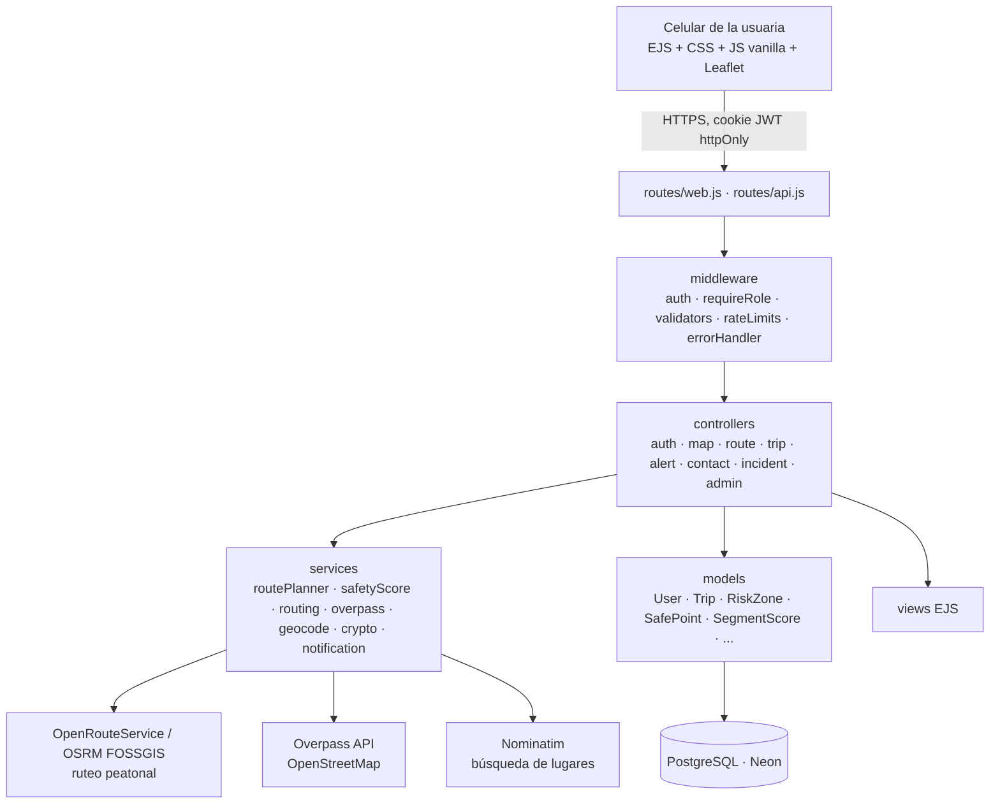

# RutaSegura Girardot · Arquitectura y decisiones técnicas

Maratón de Programación con Impacto Social (LCUP/CCPL) · Universidad de Cundinamarca · Ciclo de Profundización · 4-nov-2026

## 1. Problema y ODS
**Problemática sorteada:** ruta segura para mujeres en el espacio público nocturno, de forma translocal, con piloto en **Girardot (Cundinamarca)**.
**ODS 5** (igualdad de género: libertad de movimiento sin miedo) y **ODS 11** (ciudades inclusivas y seguras).
**Usuaria:** estudiante o trabajadora que camina de noche, con un Android de gama media, una sola mano libre, poca batería y datos limitados.

**Solución:** una aplicación web que (a) muestra zonas con poca luz o con reportes y lugares donde pedir ayuda, (b) compara la **ruta rápida** con la **ruta más segura** y explica el porqué, (c) permite pedir ayuda con un toque (123 + contactos), (d) guarda el historial, (e) recoge calificaciones y reportes de la comunidad, que mejoran el puntaje, y (f) cuenta con moderación para que nadie estigmatice un sector con reportes falsos.

## 2. Arquitectura MVC

- **Modelo (`src/models`)**: único lugar con SQL, siempre con consultas parametrizadas (`$1, $2`).
- **Vista (`src/views`)**: EJS renderizado en el servidor; escapa toda salida con `<%= %>`.
- **Controlador (`src/controllers`)**: valida, llama a modelos y servicios, y responde con una vista o con JSON `{ ok, data | error }`. No contiene SQL.
- **Servicios (`src/services`)**: lógica de negocio y APIs externas. El cálculo del puntaje son **funciones puras** con pruebas unitarias.

**Stack y por qué:**
- **Node + Express 4**: es ligero y el equipo lo conoce.
- **EJS**: con renderizado en el servidor la página funciona con poca conexión y no hace falta un framework de frontend.
- **PostgreSQL en Neon**: es el motor que exige el ciclo, tiene capa gratuita y no hay que instalarlo.
- **Render**: nube con capa gratuita y despliegue desde GitHub. Se intentó Azure primero; ver la sección 8.

## 3. Modelo de datos
13 tablas (`db/schema.sql`):
- `cities`: hace la app multi-ciudad.
- `users`: incluye rol `user`/`admin` y el consentimiento de la Ley 1581.
- `emergency_contacts`: teléfono y correo **cifrados**.
- `risk_zones` y `safe_points`: incluyen `source` = `demo` | `osm` | `comunidad`.
- `trips`: guarda la geometría como GeoJSON en JSONB.
- `trip_ratings` y `segment_scores`: calificación agregada por celda de ~100 m.
- `incidents`: estados `pending` / `approved` / `rejected`.
- `comments` y `share_links`: preparadas para trabajo futuro.
- `alerts` y `security_events`: auditoría.

Se usan coordenadas lat/lng sin PostGIS, con distancias calculadas por haversine en el servidor: es más simple y suficiente para una ciudad.

## 4. APIs externas y datos abiertos
| Servicio | Uso | Por qué | Si falla |
|---|---|---|---|
| **OpenRouteService** `foot-walking` | Ruta a pie y hasta 3 alternativas | Perfil peatonal real | Pasa a OSRM |
| **OSRM FOSSGIS** `routed-foot` | Respaldo de ruteo (hoy es el activo) | Gratis y sin clave. El OSRM público de project-osrm.org solo rutea en carro | Mensaje claro de error |
| **Overpass (OpenStreetMap)** | Estaciones de policía, comercios 24 h y luminarias | Datos abiertos reales: 28 puntos en Girardot | Servidor espejo y luego datos demo |
| **Nominatim (OSM)** | Buscar un lugar por nombre | Alternativa accesible al clic en el mapa | Lista vacía con mensaje |
| **Teselas OSM + Leaflet** | Mapa base | Gratis y abierto | — |

**A10 (SSRF):** el servidor solo llama a estos hosts fijos. Las coordenadas llegan validadas como números y nunca se aceptan URLs enviadas por el cliente. Los datos de Overpass **se guardan en caché** en `safe_points` (`npm run osm:sync`) en vez de consultarse en cada petición.

## 5. Algoritmo de puntaje de seguridad (0–100)
`src/services/safetyScoreService.js` muestrea la ruta cada 30 m y calcula:

| Factor | Efecto |
|---|---|
| Cada 30 m dentro de una zona de riesgo | −0,6 × nivel (1–5), máximo −60 |
| % del recorrido sin punto seguro ni luminaria a < 150 m | Hasta −20 |
| CAI, policía o comercio 24 h a < 100 m | +5 cada uno, máximo +15 |
| Promedio de estrellas de las celdas que cruza | De −10 a +10 |
| Si tarda más de 1,3 × la ruta rápida | −1 por cada 1 % extra |

**Cómo se eligen las rutas:**
1. Se piden alternativas a la API de ruteo.
2. Si la mejor todavía cruza una zona, se piden **2 rutas de desvío** con un punto intermedio a cada lado de la zona más grave.
3. La **segura** es la de mayor puntaje que no tarde más de +40 % que la rápida.
4. Se genera una **explicación legible** que describe *factores* ("evita un tramo con poca iluminación", "pasa a 8 m de una estación de policía") y nunca nombra barrios.

**Decisión documentada:** el `CLAUDE.md` proponía normalizar la penalización por número de puntos. La cambiamos a penalización **por metro expuesto**, porque normalizar diluye una zona peligrosa en las rutas largas.

**Límites:** los pesos son una propuesta inicial, sin validación estadística. Las zonas actuales son **demo**. El puntaje es una ayuda para decidir, no una predicción del delito.

## 6. Seguridad (OWASP Top 10)
| Riesgo | Implementado |
|---|---|
| A01 Control de acceso | ✔ `requireAuth` y `requireRole('admin')` en el servidor. Toda consulta de recorridos y contactos filtra por `user_id` (IDOR probado: 404). Los `:id` solo aceptan dígitos |
| A02 Criptografía | ✔ bcrypt (costo 11). JWT HS256 de 2 h en cookie `httpOnly`, `sameSite=strict` y `secure` en producción (verificado en Render). **Teléfono y correo de contactos cifrados con AES-256-GCM** (clave `DATA_KEY` en variables de entorno). HTTPS con HSTS. Neon con `sslmode=verify-full` |
| A03 Inyección | ✔ Solo consultas parametrizadas. `express-validator` en cada entrada (coordenadas numéricas, tipos en lista blanca, longitudes máximas). Salida escapada en EJS (XSS probado) |
| A04 Diseño inseguro | ✔ Consentimiento explícito de ubicación, minimización de datos, reportes con moderación previa y aviso de "apoyo, no garantía" |
| A05 Configuración | ✔ `helmet` con CSP estricta (sin scripts *inline*), CORS restringido a `APP_URL`, sin *stack traces* hacia la usuaria y `.env` fuera del repositorio y del paquete de despliegue |
| A07 Autenticación | ✔ Rate limit de 10 intentos fallidos cada 15 min en login y registro, contraseña de mínimo 10 caracteres con letras y números, mensaje genérico y hash ficticio para que el tiempo de respuesta no revele cuentas |
| A08/A09 Registro | ✔ Tabla `security_events`: login fallido, acceso denegado, alertas, moderación, límite de intentos y cuenta borrada |
| A10 SSRF | ✔ Hosts externos fijos |
| CSRF | ✔ Cookie `sameSite=strict` y API que solo acepta JSON |
| Ley 1581 de 2012 | ✔ Política de datos, consentimiento en el registro y en el onboarding, y **borrado de la cuenta con todos sus datos** desde "Mi red" |

## 7. UX, usabilidad y accesibilidad
**Dirección de diseño "farol"** (acompañada, cálida, nocturna):
- Fondo "noche en el Magdalena" (`#0E1A1F`), ámbar de farol (`#F2B33D`, también el color del ODS 11) y rojo de emergencia (`#B3261E`).
- Tipografías *Fraunces* (títulos) y **Atkinson Hyperlegible** (texto), esta última diseñada por el Braille Institute para baja visión.
- **El puntaje se muestra como 10 faroles encendidos y además como número**, para no depender solo de lo visual.

**WCAG 2.1 AA:**
- Contraste ≥ 4,5:1 verificado en los tokens de color.
- `label` en cada campo y errores asociados con `aria-describedby`.
- `aria-live` en los mensajes de estado del mapa.
- Foco visible de 3 px y enlace "Saltar al contenido".
- `lang="es-CO"`, objetivos táctiles de 44 px o más y texto de 17 px.
- Modo noche automático o manual, con `prefers-reduced-motion` respetado.
- Las rutas se distinguen por **color y por estilo de línea** (ámbar continua frente a gris punteada).
- El mapa tiene alternativas: lista textual de zonas y puntos, y búsqueda por nombre.

**Usabilidad:**
- Onboarding de 3 pasos: rutas, cómo pedir ayuda y consentimiento.
- Ayuda contextual "¿Cómo calculamos el puntaje?" y "¿Para qué sirve?" en el ajuste de inactividad.
- Pedir ayuda toma **1 toque** (con 3 s para cancelar). Trazar una ruta toma **3 toques**: origen, destino y "Trazar".
- **Control de inactividad:** durante el recorrido, si pasan N minutos sin interacción (configurable de 1 a 60), aparece "¿Estás bien?" con alarma. Si no hay respuesta en 20 s, se envía la alerta con `reason = 'inactividad'`.

**Prueba de usabilidad** (a completar por el equipo con un compañero de otro equipo):
| Tarea | Tiempo | Problemas observados | Corrección aplicada |
|---|---|---|---|
| Trazar una ruta segura | [completar] | [completar] | [completar] |
| Pedir ayuda | [completar] | [completar] | [completar] |
| Calificar un recorrido | [completar] | [completar] | [completar] |

## 8. Escalabilidad y sostenibilidad
- **Otros municipios:** basta con insertar una fila en `cities` (centro y recuadro) y ejecutar `npm run osm:sync`. El código no tiene a Girardot "quemado".
- **Escala técnica:** el servidor no guarda estado (JWT), así que se pueden agregar instancias en Azure sin cambios. Para crecer: PostGIS con índices espaciales, caché de rutas frecuentes y una cola para notificaciones.
- **Despliegue:** https://rutassegurasgirardot.onrender.com, en **Render** (Web Service gratuito, región Ohio, la misma zona de AWS que Neon) con despliegue automático desde GitHub.
  - **Por qué no Azure:** se intentó primero, porque el reglamento pide AWS, GCP o Azure. La suscripción *Azure for Students* rechazó East US, East US 2 y otras regiones por la política *"Allowed resource deployment regions"*. En la región permitida, la creación falló por **cuota 0 de máquinas F1 y B1** (*"Operation cannot be completed without additional quota"*), y ampliar la cuota requiere una solicitud a soporte que no cabía en las 2,5 h. Se usó Render como alternativa declarada. La app no depende del proveedor: migrarla a Azure App Service es cargar las mismas variables de entorno.
- **Costo actual: $0** (Render Free + Neon Free + APIs abiertas). Límites: Render Free se suspende tras 15 min sin uso (primer arranque de unos 50 s); ORS permite 2.000 rutas al día gratis.
- **Sostenibilidad social:** alianzas con la Alcaldía, la Secretaría de la Mujer y la Policía para reemplazar los datos demo por datos oficiales, y con universidades para moderar reportes.

## 9. Limitaciones honestas
- Las **zonas de riesgo son datos demo**: deben validarse con la comunidad y las autoridades antes de un uso real.
- Una web **no puede subir el volumen** del celular: la alarma suena al volumen actual (se avisa en el onboarding).
- En **segundo plano**, el navegador puede pausar el seguimiento y el Wake Lock.
- OpenStreetMap tiene **poca cobertura** de luminarias en Girardot (16 registradas).
- El aviso a contactos por Telegram se **simula** si no hay credenciales. Los enlaces de WhatsApp y SMS funcionan desde el celular de la usuaria.
- El rol viaja dentro del JWT: un cambio de rol se aplica cuando vence el token (2 h).

## 10. Trabajo futuro
Ubicación compartida en tiempo real con enlace que vence (SSE; las tablas ya existen), *heartbeat* al servidor durante el recorrido, notificaciones reales por Telegram o SMS, rutas comunitarias, datos oficiales de Policía y Alcaldía, predicción de riesgo por hora con modelos de ML evaluados por sesgo, y app móvil nativa.
